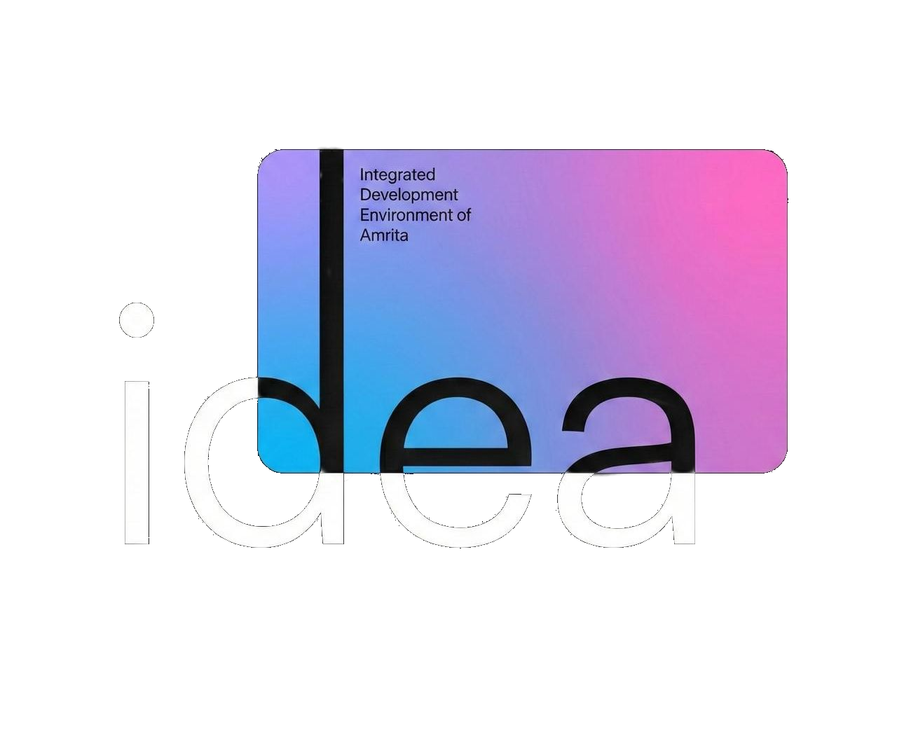

  

<h1 align="center">iDEA</h1>

  <strong>Integrated Development Environment of Amrita</strong>

  Innovation · Research · Development · Entrepreneurship

  Amrita Vishwa Vidyapeetham · Coimbatore, India

  <a href="https://ideacommunity.in">Website</a> ·
  <a href="https://github.com/IDEA-Amrita">GitHub</a>

---

## About iDEA

iDEA is a student-led innovation and development community at Amrita Vishwa Vidyapeetham, Coimbatore, built around a simple principle: **ideas should move beyond discussion into research, engineering, and real-world implementation.**

We bring together students passionate about technology, computer science, research, and entrepreneurship to identify meaningful problems, explore unconventional solutions, and build products that create tangible impact.

Our approach connects ideation with execution. Members investigate problem statements, evaluate existing approaches, validate assumptions, define project requirements, and collaborate to develop solutions. Projects can progress from initial concepts to working prototypes, production-ready systems, research publications, industry collaborations, and potential startup ventures.

At iDEA, we aim to build more than individual projects. We cultivate an engineering-driven environment where students develop technical depth, take ownership of their work, collaborate across disciplines, and learn to navigate the complete development lifecycle.

## What We Do

### Research and Exploration
We explore emerging technologies, investigate open problems, examine existing research, and encourage critical thinking. Members develop the ability to formulate research questions, evaluate methodologies, and translate findings into practical outcomes.

### Project Development
We turn validated ideas into working solutions through collaborative engineering. Teams work through requirements, system design, implementation, testing, documentation, deployment, and maintenance.

### Special Interest Groups
Our Special Interest Groups (SIGs) provide focused environments for members to explore technical domains, exchange knowledge, build expertise, and identify opportunities for collaborative projects.

### Innovation and Entrepreneurship
Promising projects can progress toward industry partnerships, external mentorship, funding opportunities, incubation, and startup development. We aim to connect technical innovation with meaningful applications and sustainable products.

### Community-Centred Solutions
We encourage students to identify real-world challenges and develop solutions that address practical needs. Community impact, accessibility, and relevant United Nations Sustainable Development Goals (SDGs) can inform project selection and evaluation.

## From Ideas to Impact

Our project pipeline connects ideation, validation, development, and execution.

1. **Ideation**  
   Identify problems, propose solutions, and articulate the value of an idea.

2. **Research and Validation**  
   Investigate existing approaches, evaluate feasibility, test assumptions, and refine the problem statement.

3. **Scoping and Planning**  
   Define requirements, determine deliverables, identify the necessary skill sets, and establish a practical development plan.

4. **Engineering and Development**  
   Form project teams and build solutions through iterative implementation, testing, and review.

5. **Evaluation and Publication**  
   Assess outcomes, document technical decisions, present findings, and explore research publication where appropriate.

6. **Deployment and Progression**  
   Take successful projects toward practical deployment, industry collaboration, further funding, incubation, or startup development.

Throughout this process, we value clear documentation, reproducible results, thoughtful engineering decisions, and continuous improvement.

<!-- Hidden cause I will make it happen with next set of OB's. Properly gonna leave the club with structure
## How We Work

iDEA operates through specialised teams that contribute different capabilities to a shared innovation pipeline.

- **Management:** Coordinates organisational operations, inter-team collaboration, planning, and community events.
- **Visionary:** Supports continuity between leadership terms and helps preserve the long-term direction of the community.
- **Ideation:** Reviews proposed ideas, refines problem statements, supports validation, and helps formalise project requirements.
- **Human Resources:** Coordinates membership, interpersonal concerns, project tracking, and resource allocation.
- **Curation:** Communicates projects, research, achievements, resources, and events to the wider community.
- **Internal Development:** Maintains the club's digital infrastructure and develops technical tools that improve internal workflows.
- **Advisory:** Connects members with experienced alumni who can contribute industry perspectives, mentorship, and guidance.

These teams work collaboratively while maintaining responsibility for their respective functions. -->

## Learning Through Building

We believe meaningful technical growth comes from working on real problems and taking responsibility for complete outcomes.

Through iDEA, members develop experience in:

- Software engineering, system design, and maintaining existing codebases.
- Research methodology, literature reviews, experimentation, and technical writing.
- Team collaboration, project management, documentation, and communication.
- Evaluating ideas, defending technical decisions, and incorporating feedback.
- Presenting projects, sharing knowledge, and engaging with the wider technology community.

The objective is not simply to build more projects. It is to develop the technical judgement, research discipline, and collaborative skills needed to build better ones.

<!-- Hidden cause I gotta make it happen before I put it here. Public about it, but it is what it is
## Community and Events

We use regular interactions and community-wide events to encourage learning, accountability, and knowledge exchange.

- **Project Reviews:** Teams present progress, discuss engineering challenges, evaluate outcomes, and identify next steps.
- **Technical Discussions:** Members explore emerging technologies, research developments, and new problem statements.
- **Knowledge Sharing:** Members exchange technical expertise, document useful resources, and learn from one another's work.
- **Showcases and Events:** Projects and research outcomes are presented to the wider student community, creating opportunities for collaboration and engagement.

These activities connect individual project work to a broader culture of innovation. -->

## iDEA Alumni Network

iDEA's community extends beyond current members. Its alumni have pursued opportunities across industry, research, engineering, and entrepreneurship.

The alumni network provides a bridge between student-led innovation and professional experience. Alumni can contribute perspectives on technical careers, emerging industry needs, research directions, and product development.

Their experiences help current members understand how the skills developed through collaborative engineering and research can translate into meaningful work beyond university.

## Our Vision

We envision a community where students have the environment, guidance, and opportunity to take an idea from its earliest formulation to a solution that matters.

A place where research informs engineering, engineering enables innovation, and innovation creates tangible impact.

We strive to build a sustainable ecosystem that supports technical excellence, interdisciplinary collaboration, responsible problem-solving, and the development of ideas into enduring projects and products.

---

  <strong>iDEA</strong> 
  From Ideas to Impact.

